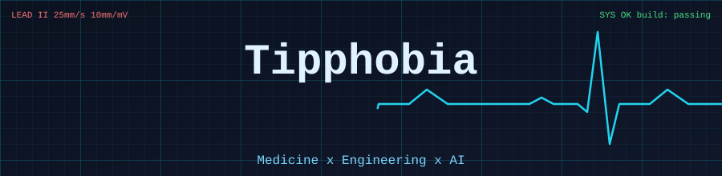
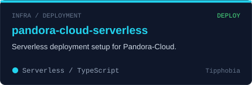

  
  

## About

Medical student building software in the overlap of **medicine, engineering, and AI**.

Medicine trains you to care about evidence, edge cases, and what happens when assumptions break. Engineering lets you turn a repetitive workflow into something reproducible, inspectable, and actually usable. Most of my projects sit somewhere between the two.

## Focus

<table>
<tr>
<td width="50%" valign="top">

### Medical Research & Agents

- Publication-oriented research workflows
- Agent-first tooling with traceable outputs
- Keeping evidence verifiable and humans in review

</td>
<td width="50%" valign="top">

### Systems & Tooling

- LLM applications that solve concrete bottlenecks
- Clean interfaces, predictable failure modes
- Lightweight and low-cost deployment

</td>
</tr>
</table>

## Selected Work

- [**med-autoscience**](https://github.com/Tipphobia/med-autoscience) — Medical implementation of Research Foundry for agent-first, publication-oriented Research Ops.
- [**pandora-cloud-serverless**](https://github.com/Tipphobia/pandora-cloud-serverless) — Serverless deployment setup for Pandora-Cloud.

## GitHub Activity

Still learning. Still building.

